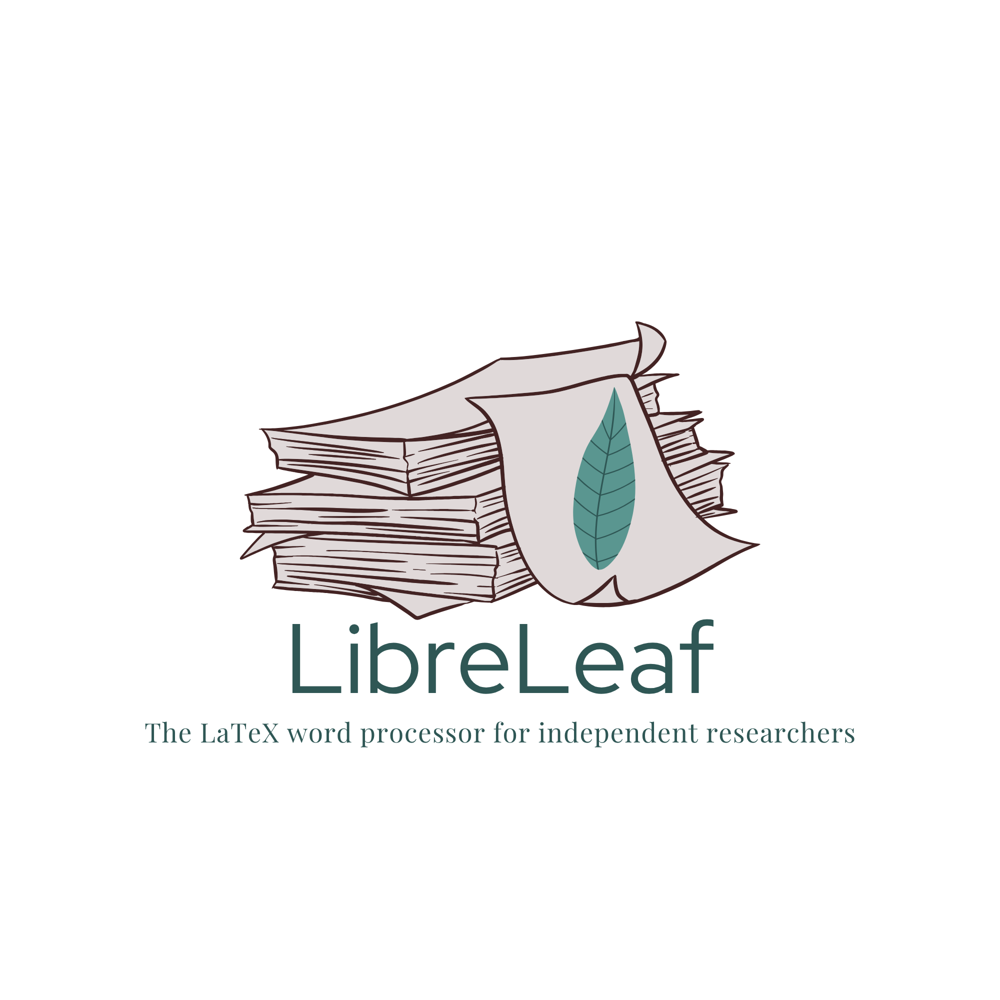

<p align="center">
  
</p>

# LibreLeaf

[](LICENSE)
[](https://github.com/eagnespuerto/libreleaf/releases/latest)
[](https://github.com/eagnespuerto/libreleaf)
[](https://eagnespuerto.github.io/libreleaf/)
[](https://ko-fi.com/eagnespuerto)
[](https://linktr.ee/soitsagnes)

**The LaTeX word processor for independent researchers.**

LibreLeaf is a free, open-source LaTeX editor that you use like a word
processor. It's for citizen scientists and independent researchers who don't
have an adviser or a lab to teach them LaTeX and journal formatting. It works
like Google Docs, with a Word-style ribbon, and explains errors in plain
language. Every feature is free, with no paywalls. The project is paid for by
donations.

> **Status: v0.0.3 alpha.** A first draft of the word processor, for Windows,
> Linux and Raspberry Pi OS: open a `.tex` file, edit it on a page, and save it
> back. It can't compile to PDF yet. The word counter still runs in the browser.
> **Download:** [Releases](https://github.com/eagnespuerto/libreleaf/releases)
> · **Word counter:** https://eagnespuerto.github.io/libreleaf/

## The word processor (draft)

Download the installer for your system from
[Releases](https://github.com/eagnespuerto/libreleaf/releases):

| System | File |
|---|---|
| Windows 10/11 (x64) | `LibreLeaf_…_x64-setup.exe` or `.msi` |
| Debian, Ubuntu, Mint (x64) | `LibreLeaf_…_amd64.deb` or `.AppImage` |
| Fedora (x64) | `LibreLeaf-…x86_64.rpm` |
| Raspberry Pi OS 64-bit, Bookworm or later (Pi 4, Pi 5, Pi 400) | `LibreLeaf_…_arm64.deb` |

On a Pi: `sudo apt install ./LibreLeaf_0.0.3_arm64.deb`.

What works now:

- Open a `.tex` file and edit it on a page: sections, paragraphs, bold,
  emphasis, small caps, lists and footnotes, from a Word-style ribbon.
- Anything the editor doesn't understand yet (the preamble, maths, figures,
  `\cite`) shows as LaTeX in a box, and you can edit it as text. Nothing is
  lost: a file you open and save without changes comes back the same.
- See the LaTeX it will save (View > LaTeX source), and a live word count.
- Your draft is kept between sessions.

How the editor stores documents is explained in
[ADR 0001](docs/adr/0001-doc-model.md). Where it will compile is
[ADR 0002](docs/adr/0002-deployment.md).

## The word counter

**LibreLeaf TeXCount** is a word counter for LaTeX that follows the same rules
as [TeXCount](https://app.uio.no/ifi/texcount/). It runs in your browser, and
your files never leave your computer. It works from the command line too.

On 23 recent arXiv papers it agrees with TeXCount to within 1% on 19 of them.
The other four differ for known reasons. See
[docs/texcount-comparison.md](docs/texcount-comparison.md).

It shows:
- the **sum**: text + headings + captions and footnotes
- separate counts for running text, headings, captions and the abstract
- inline and displayed maths, headings, and figures/tables
- a per-section breakdown
- a word-limit check against a journal's limit (in the web version)

You can leave the abstract, or captions and footnotes, out of the sum. In the
browser, select part of the source to count only that part.

**Projects with several files.** Open a folder or a .zip (an Overleaf download
works). LibreLeaf finds the main file and follows `\input`, `\include`,
`\subfile`, `\import` and `\subimport`.

### Command line

Needs Node.js 18 or newer. There are no dependencies.

```bash
node packages/texcount/texcount.js main.tex
node packages/texcount/texcount.js my-paper/
```

Give it the main file or the project folder. Options:

| Option | What it does |
|---|---|
| `--json` | Machine-readable output |
| `--no-inputs` | Count one file only |
| `--no-abstract` | Leave the abstract out of the sum |
| `--no-captions` | Leave captions and footnotes out of the sum |
| `--math-words` | Count each maths item as one word, like `texcount -sum` |

### Counting rules

- Only the document body counts, plus `\title`.
- Citations, `\ref`/`\label`, URLs, package setup and macro definitions are
  skipped. The link text in `\href` counts.
- Verbatim, code listings, TikZ, comments, `tabular` contents and
  `thebibliography` are skipped.
- In figures and tables, only captions count.
- Footnotes count outside the text, together with captions, as in TeXCount.
- The abstract counts as text, and its "Abstract" heading counts as a heading.
- Lines between `%TC:ignore` and `%TC:endignore` are skipped.
- Accents stay inside words, so `Erd\H{o}s` is one word.

Where LibreLeaf deliberately differs from TeXCount (for example, it doesn't
count `\cref` labels as words) is listed in the
[comparison](docs/texcount-comparison.md#known-differences).

### Development

```bash
npm install
npm test            # word counter and doc-model tests
npm run dev         # the editor in your browser, at http://localhost:5173
npm run roundtrip -- path/to/projects   # ADR 0001 round-trip table
```

The desktop app needs [Rust](https://rustup.rs) and, on Linux,
`libwebkit2gtk-4.1-dev`. Then, in `apps/web`: `npx tauri dev` or
`npx tauri build`. Pushing a `v*` tag builds the installers for all three
systems on GitHub Actions and attaches them to a draft release.

The landing page and word counter are plain HTML served from the root of
`main` by GitHub Pages, with no build step.

## Roadmap

- Next six weeks, version by version: [docs/ROADMAP.md](docs/ROADMAP.md)
- Product spec and phases: [docs/SPEC.md](docs/SPEC.md)
- Design, ribbon, colours and type: [docs/DESIGN.md](docs/DESIGN.md)
- Brand palette page: [docs/brand/palette.html](https://eagnespuerto.github.io/libreleaf/docs/brand/palette.html)

The first full release is planned as a single-user desktop app (Windows and
Linux, through Tauri), followed by a web version. The final hosted version is
being evaluated on Render.

## License

[AGPL-3.0](LICENSE) © 2026 Ella Agnes Puerto
