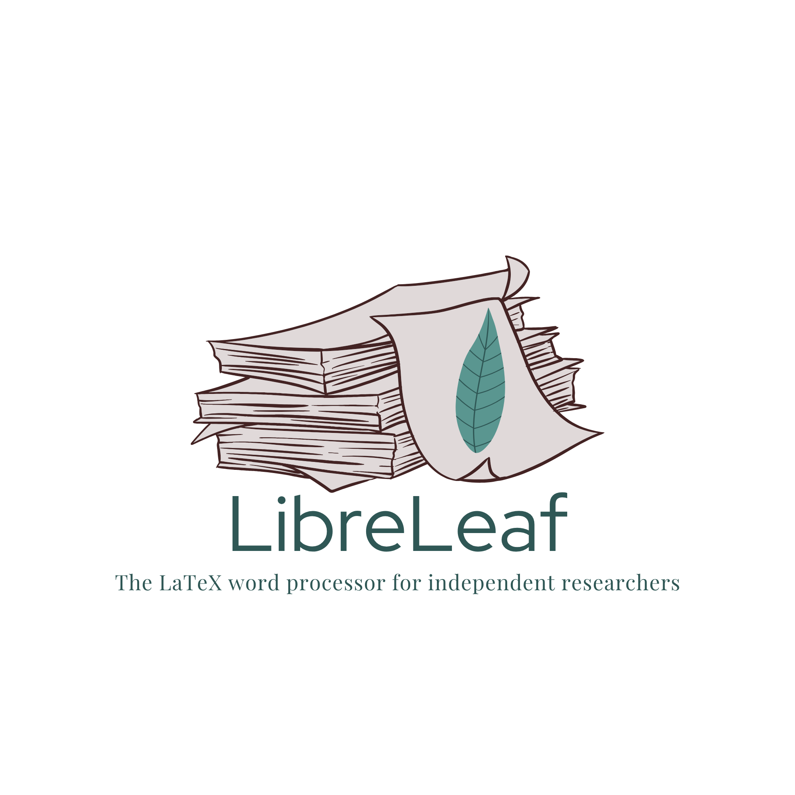

<p align="center">
  
</p>

# LibreLeaf

**The LaTeX word processor for independent researchers.**

LibreLeaf is a free, open-source LaTeX editor that you use like a word
processor. It's for citizen scientists and independent researchers who don't
have an adviser or a lab to teach them LaTeX and journal formatting. It works
like Google Docs, with a Word-style ribbon, and explains errors in plain
language. Every feature is free, with no paywalls. The project is paid for by
donations.

> **Status: v0.0.1 alpha.** The editor isn't built yet. This first release is
> its word counter.
> **Try it:** https://eagnespuerto.github.io/libreleaf/

## What's in v0.0.1

**LibreLeaf TeXCount** is a word counter for LaTeX that follows the same rules
as [TeXCount](https://app.uio.no/ifi/texcount/). It runs in your browser, and
your file never leaves your computer. It works from the command line too.

It shows:
- the **sum count** (text + headings + captions), as TeXCount does
- separate counts for running text, headings, captions and the abstract
- inline and displayed maths, headings, and figures/tables
- a per-section breakdown
- a word-limit check against a journal's limit (in the web version)

### Command line

Needs Node.js 18 or newer. There are no dependencies.

```bash
node packages/texcount/texcount.js main.tex
```

It follows `\input` and `\include`. Add `--json` for machine-readable output,
or `--no-inputs` to count one file only.

### Counting rules

- Only the document body counts, plus `\title`.
- Citations, `\ref`/`\label`, URLs, package setup and macro definitions are
  skipped. The link text in `\href` counts.
- Verbatim, code listings, TikZ, comments and `thebibliography` are skipped.
- In figures and tables, only captions count.
- Footnotes count as text. Accents stay inside words, so `Erd\H{o}s` is one
  word.

### Development

```bash
npm test
```

The site is plain HTML served from the root of `main` by GitHub Pages. There's
no build step.

## Roadmap

- Product spec and phases: [docs/SPEC.md](docs/SPEC.md)
- Design, ribbon, colours and type: [docs/DESIGN.md](docs/DESIGN.md)
- Brand palette page: [docs/brand/palette.html](https://eagnespuerto.github.io/libreleaf/docs/brand/palette.html)

The first full release is planned as a single-user desktop app (Windows and
Linux, through Tauri), followed by a web version. The final hosted version is
being evaluated on Render.

## License

[AGPL-3.0](LICENSE) © 2026 Ella Agnes Puerto
